# Foraeldrehelte Design System

You are building UI for **Foraeldrehelte**. Light-themed, cool palette, sans-serif typography (Arial), standard density on a 5px grid.

## Visual Reference

**IMPORTANT**: Study ALL screenshots below before writing any UI. Match colors, typography, spacing, layout, and motion exactly as shown.

### Scroll Journey (Cinematic Visual States)

> These screenshots capture the website at different scroll depths. The design changes dramatically as you scroll — each frame shows a different cinematic state. Replicate these exact visual transitions.

#### 0% — Hero / Above the fold

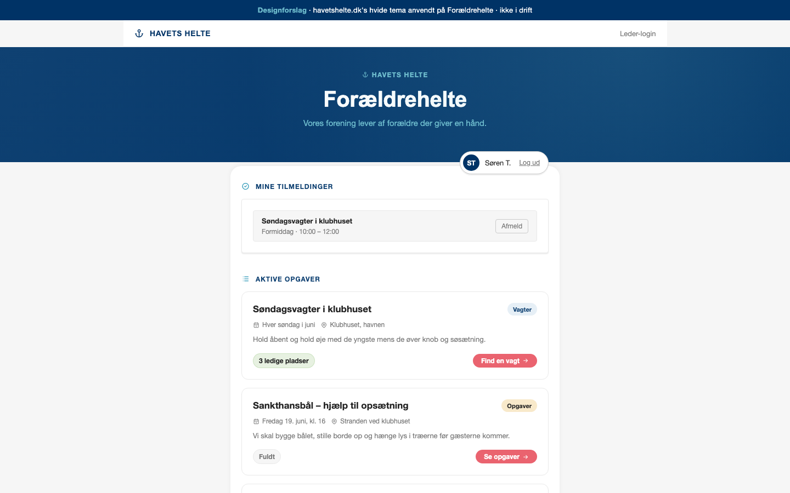

#### 17% — Mid-page at 17% scroll

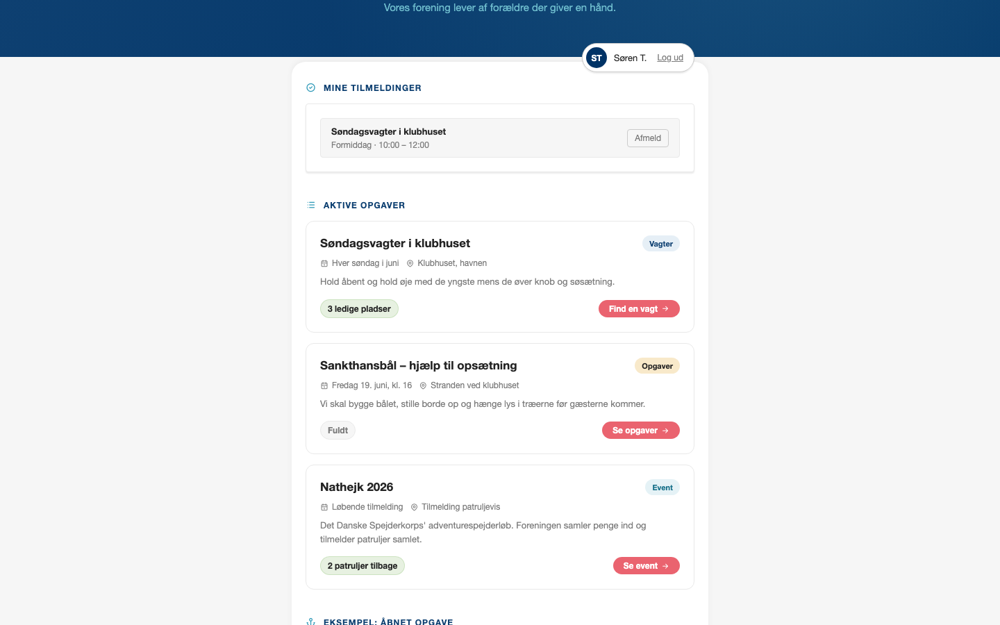

#### 33% — Mid-page at 33% scroll

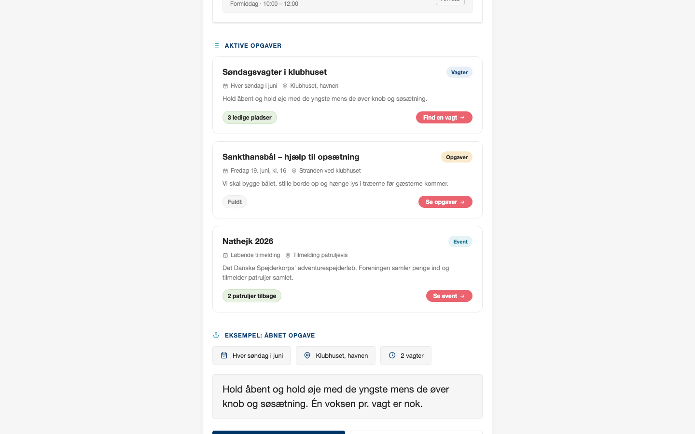

#### 50% — Mid-page at 50% scroll

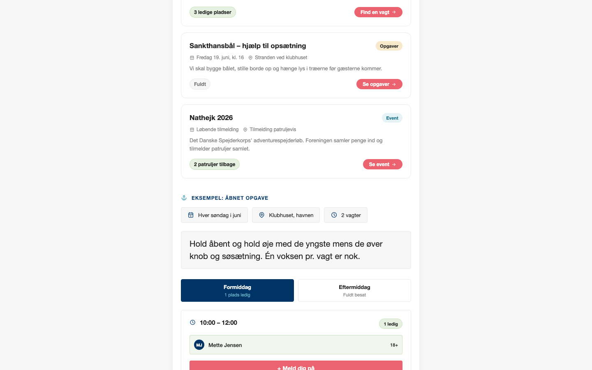

#### 67% — Mid-page at 67% scroll

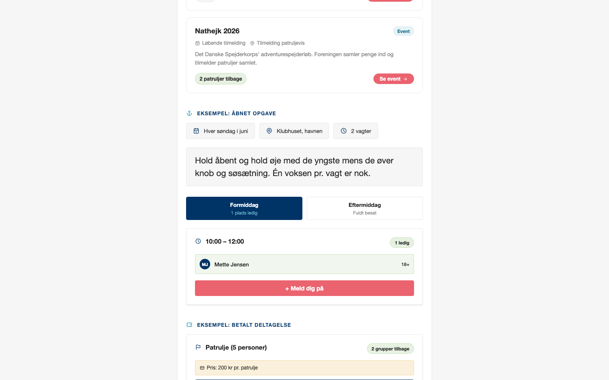

#### 83% — Mid-page at 83% scroll

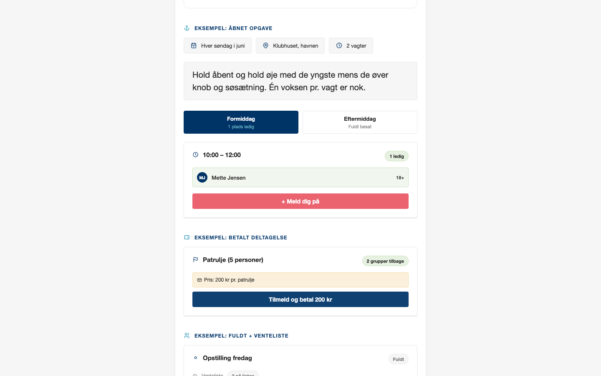

#### 100% — Footer / End of page

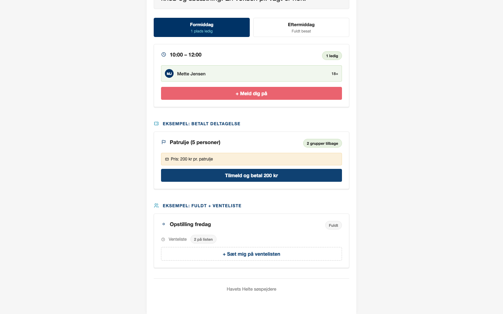

> Read `references/DESIGN.md` for full token details. Read `references/ANIMATIONS.md` for motion specs. Read `references/LAYOUT.md` for layout structure. Read `references/COMPONENTS.md` for component patterns.

## Ultra Reference Files

This package includes extended documentation. **Read these files before implementing:**

| File | Contents |
|------|----------|
| `references/DESIGN.md` | Full design system tokens, colors, typography, spacing |
| `references/VISUAL_GUIDE.md` | **START HERE** — Master visual guide with all screenshots embedded |
| `references/ANIMATIONS.md` | CSS keyframes, scroll triggers, motion library stack, video specs |
| `references/LAYOUT.md` | Flex/grid containers, page structure, spacing relationships |
| `references/COMPONENTS.md` | DOM component patterns, HTML structure, class fingerprints |
| `references/INTERACTIONS.md` | Hover/focus states with before/after style diffs |
| `screens/scroll/` | 7 scroll journey screenshots showing cinematic states |

## Design Philosophy

- **Layered depth** — use shadow tokens to create a sense of physical layering. Each elevation level has a specific shadow.
- **Gradient accents** — gradients are used thoughtfully for emphasis, not decoration.
- **Type pairing** — Helvetica Neue for body/UI text, Arial for headings/display. Never introduce a third typeface.
- **standard density** — 5px base grid. Every dimension is a multiple of 5.
- **cool palette** — the color temperature runs cool, matching the sans-serif typography.
- **Restrained accent** — `#ea636f` (coral) is the primary pop of color, reserved for CTAs and primary actions (join/signup buttons, confirm). `#337ab7` is declared as `--accent` but is not actually wired to any component in this build — treat it as a reserved/secondary structural color, not the active brand accent.
- **Subtle motion** — transitions smooth state changes. Keep durations under 300ms, use ease-out curves.

## Color System

### Core Palette

| Role | Token | Hex | Use |
|------|-------|-----|-----|
| Background | `--bg` | `#f6f6f6` | Page/app background |
| Surface | `--surface` | `#ffffff` | Cards, panels, modals |
| Text Primary | `--text` | `#232323` | Headings, body text |
| Text Muted | `--muted` | `#7c7c7c` | Captions, placeholders |
| Primary Accent | `--coral` | `#ea636f` | CTAs, primary/join buttons, confirm actions, error-state hover |

### Status Colors

| Status | Hex | Use |
|--------|-----|-----|
| Success | `#c9e1bd` | Confirmations, positive trends |
| Warning | `#f4daa6` | Caution states, pending items |
| Danger | `#ea636f` | Same hex as the primary accent above — this build reuses coral for both CTA and implicit error-hover (`.mine-cancel:hover`), it does not have a separate dedicated danger color |

### Extended Palette

- `--navy: #003366` — headings, nav, primary text-on-light-surface emphasis
- `--navy-mid: #0f4172` — paid-action buttons, focus borders, secondary icon color
- `--teal: #2c98b7` — section-label icons, "event" type accents
- `--teal-deep: #146e88` — "event" type badge text
- `--teal-light: #6ebccd` — light text on navy surfaces (hero subtitle, active-tab subtext)
- `--row-bg: #f6f6f6` — recessed rows inside white cards (same value as page background)
- `--border: #cbcbcb`, `--border-soft: #e9e9e9` — card/divider borders
- `--accent: #337ab7` — declared, unused in this build (see note above)

### CSS Variable Tokens

```css
--bg:#f6f6f6; --surface:#ffffff; --row-bg:#f6f6f6;
--text:#232323; --navy:#003366; --navy-mid:#0f4172; --muted:#7c7c7c;
--border:#cbcbcb; --border-soft:#e9e9e9;
--success:#c9e1bd; --warning:#f4daa6; --coral:#ea636f;
--accent:#337ab7; --teal:#2c98b7; --teal-deep:#146e88; --teal-light:#6ebccd;
```

## Typography

### Font Stack

- **Helvetica Neue** — Body, Caption, UI text
- **Arial** — Heading 1, Heading 2, Heading 3, display

### Type Scale

| Role | Family | Size | Weight |
|------|--------|------|--------|
| Heading 1 | Arial | clamp(30px,7vw,40px) | 700 |
| Heading 2 | Arial | 20px | 700 |
| Heading 3 | Arial | 18px | 700 |
| Body | Helvetica Neue | 17px | 400 |
| Caption | Helvetica Neue | 16px | 400 |

### Typography Rules

- Body/UI: **Helvetica Neue**, Headings: **Arial** — these are the only display fonts
- Max 3-4 font sizes per screen
- Headings: weight 600-700, body: weight 400
- Use color and opacity for text hierarchy, not additional font sizes
- Line height: 1.5 for body, 1.2 for headings

## Spacing & Layout

### Base Grid: 5px

Every dimension (margin, padding, gap, width, height) must be a multiple of **5px**.

### Spacing Scale

`5, 10, 15, 20, 25, 30, 35, 40, 60` px

### Spacing as Meaning

| Spacing | Use |
|---------|-----|
| 2.5-5px | Tight: related items within a group |
| 10px | Medium: between groups |
| 15-20px | Wide: between sections |
| 30px+ | Vast: major section breaks |

### Border Radius

Scale: `4px, 12px, 20px 20px 0px 0px, 50px, 999px`
Default: `4px` (used by cards, buttons, inputs). `20px 20px 0px 0px` is a one-off, used only by the content sheet pulled over the hero. `50px` is the modal's radius. `999px` is the pill radius for badges/CTAs.

### Container

Max-width: `991px`, centered with auto margins.

## Component Patterns

### Card

```css
.card {
  background: #ffffff;
  border-radius: 4px;
  padding: 20px;
  box-shadow: 0 2px 2px rgba(0,0,0,.08);
}
```

```html
<div class="card">
  <h3>Card Title</h3>
  <p>Card content goes here.</p>
</div>
```

### Button

```css
/* Primary */
.btn-primary {
  background: #ea636f;
  color: #ffffff;
  border-radius: 4px;
  padding: 10px 20px;
  font-weight: 700;
  transition: opacity 150ms ease;
}
.btn-primary:hover { opacity: 0.88; }

/* Ghost */
.btn-ghost {
  background: transparent;
  border: 1px solid #cbcbcb;
  color: #232323;
  border-radius: 4px;
  padding: 10px 20px;
}
```

```html
<button class="btn-primary">Get Started</button>
<button class="btn-ghost">Learn More</button>
```

### Input

```css
.input {
  background: #f6f6f6;
  border: 1px solid #cbcbcb;
  border-radius: 4px;
  padding: 10px 15px;
  color: #232323;
  font-size: 14px;
}
.input:focus { border-color: #0f4172; outline: none; }
```

```html
<input class="input" type="text" placeholder="Search..." />
```

### Badge / Chip

```css
.badge {
  display: inline-flex;
  align-items: center;
  padding: 5px 10px;
  border-radius: 999px;
  font-size: 12px;
  font-weight: 500;
  background: #ffffff;
  color: #7c7c7c;
}
```

```html
<span class="badge">New</span>
<span class="badge">Beta</span>
```

### Modal / Dialog

```css
.modal-backdrop { background: rgba(0, 15, 30, 0.55); }
.modal {
  background: #ffffff;
  border-radius: 50px;
  padding: 35px 30px;
  max-width: 420px;
  width: 100%;
  box-shadow: 0 0 5px #666666;
}
```

```html
<div class="modal-backdrop">
  <div class="modal">
    <h2>Dialog Title</h2>
    <p>Dialog content.</p>
    <button class="btn-primary">Confirm</button>
    <button class="btn-ghost">Cancel</button>
  </div>
</div>
```

### Table

```css
.table { width: 100%; border-collapse: collapse; }
.table th {
  text-align: left;
  padding: 10px 15px;
  font-weight: 500;
  font-size: 12px;
  color: #7c7c7c;
  text-transform: uppercase;
  letter-spacing: 0.05em;
  border-bottom: 1px solid #cccccc;
}
.table td {
  padding: 15px;
  border-bottom: 1px solid #cccccc;
}
```

```html
<table class="table">
  <thead><tr><th>Name</th><th>Status</th><th>Date</th></tr></thead>
  <tbody>
    <tr><td>Item One</td><td>Active</td><td>Jan 1</td></tr>
    <tr><td>Item Two</td><td>Pending</td><td>Jan 2</td></tr>
  </tbody>
</table>
```

### Navigation

```css
.nav {
  display: flex;
  align-items: center;
  gap: 10px;
  padding: 15px 20px;
}
.nav-link {
  color: #7c7c7c;
  padding: 10px 15px;
  border-radius: 20px 20px 0px 0px;
  transition: color 150ms;
}
.nav-link:hover { color: #232323; }
.nav-link.active { color: #ea636f; }
```

```html
<nav class="nav">
  <a href="/" class="nav-link active">Home</a>
  <a href="/about" class="nav-link">About</a>
  <a href="/pricing" class="nav-link">Pricing</a>
  <button class="btn-primary" style="margin-left: auto">Get Started</button>
</nav>
```

### Extracted Components

These components were found in the codebase:

**Button** (`html`)
- Variants: `paid`, `waitlist`, `cancel`, `confirm`

**Badge** (`html`)

## Page Structure

The following page sections were detected:

- **Hero** — Hero/banner section with headline and CTAs
- **Cta** — Call-to-action section

When building pages, follow this section order and structure.

## Animation & Motion

This project uses **subtle motion**. Transitions smooth state changes without calling attention.

### CSS Animations

- `fadeIn`

### Motion Tokens

- **Easing functions:** `ease`
- **Animated properties:** `box-shadow`, `border-color`

### Motion Guidelines

- **Duration:** 150-300ms for micro-interactions, 300-500ms for page transitions
- **Easing:** Use `ease` as the default easing curve
- **Direction:** Elements enter from bottom/right, exit to top/left
- **Reduced motion:** Always respect `prefers-reduced-motion` — disable animations when set

## Depth & Elevation

### Shadow Tokens

- Subtle: `rgba(0, 0, 0, 0.08) 0px 2px 2px 0px`
- Raised (cards, buttons): `var(--shadow-flat)`
- Raised (cards, buttons): `var(--shadow-soft)`
- Raised (cards, buttons): `rgb(102, 102, 102) 0px 0px 5px 0px`
- Floating (dropdowns, popovers): `0-2px 10px rgba(0,0,0,.05)`
- Floating (dropdowns, popovers): `rgba(0, 0, 0, 0.05) 0px -2px 10px 0px`

## Anti-Patterns (Never Do)

- **No blur effects** — no backdrop-blur, no filter: blur()
- **No zebra striping** — tables and lists use borders for separation
- **No invented colors** — every hex value must come from the palette above
- **No arbitrary spacing** — every dimension is a multiple of 5px
- **No extra fonts** — only Arial and Helvetica Neue are allowed
- **No arbitrary border-radius** — use the scale: 4px, 12px, 50px, 999px
- **No opacity for disabled states** — use muted colors instead

## Workflow

1. **Read** `references/DESIGN.md` before writing any UI code
2. **Pick colors** from the Color System section — never invent new ones
3. **Set typography** — Arial, Helvetica Neue only, using the type scale
4. **Build layout** on the 5px grid — check every margin, padding, gap
5. **Match components** to patterns above before creating new ones
6. **Apply elevation** — use shadow tokens
7. **Validate** — every value traces back to a design token. No magic numbers.

## Brand Spec

- **Favicon:** `/favicon.ico`
- **Site URL:** `http://localhost:8743`
- **Brand color:** `#ea636f`
- **Brand typeface:** Arial

## Quick Reference

```
Background:     #f6f6f6
Surface:        #ffffff
Text:           #232323 / #7c7c7c
Accent:         #ea636f
Border:         `#cbcbcb`
Font:           Arial
Spacing:        5px grid
Radius:         20px 20px 0px 0px
Components:     6 detected
```

## When to Trigger

Activate this skill when:
- Creating new components, pages, or visual elements for Foraeldrehelte
- Writing CSS, Tailwind classes, styled-components, or inline styles
- Building page layouts, templates, or responsive designs
- Reviewing UI code for design consistency
- The user mentions "Foraeldrehelte" design, style, UI, or theme
- Generating mockups, wireframes, or visual prototypes

---

# Full Reference Files

> Every output file is embedded below. Claude has full design system context from /skills alone.

## Design System Tokens (DESIGN.md)

# Foraeldrehelte DESIGN.md

> Auto-generated design system — reverse-engineered via static analysis by skillui.
> Frameworks: None detected
> Colors: 17 · Fonts: 2 · Components: 6
> Icon library: not detected · State: not detected
> Primary theme: light · Dark mode toggle: no · Motion: subtle

---

## 1. Visual Theme & Atmosphere

This is a **light-themed** interface with a cool, approachable feel. The light background emphasizes content clarity. Typography pairs **Helvetica Neue** for body text with **Arial** for display/headings, creating clear visual hierarchy through type contrast. Spacing follows a **5px base grid** (standard density), with scale: 5, 10, 15, 20, 25, 30, 35, 40px. The primary accent color **#ea636f** (coral) anchors interactive elements (buttons, links, focus rings). Motion is subtle — smooth transitions (150-300ms) ease state changes without drawing attention.

---

## 2. Color Palette & Roles

| Token | Hex | Role | Use |
|---|---|---|---|
| background | `#f6f6f6` | background | Page background, darkest surface |
| surface | `#ffffff` | surface | Card and panel backgrounds |
| border-soft | `#e9e9e9` | surface | Card and panel backgrounds |
| text | `#232323` | text-primary | Headings and body text |
| muted | `#7c7c7c` | text-muted | Captions, placeholders, secondary info |
| accent | `#ea636f` | accent | CTAs, links, focus rings, active states |
| accent | `#146e88` | accent | CTAs, links, focus rings, active states |
| danger | `#ea636f` | danger | Error states, destructive actions |
| success | `#c9e1bd` | success | Success states, positive indicators |
| warning | `#f4daa6` | warning | Warning states, caution indicators |
| info | `#0f4172` | info | Informational highlights |
| unknown | `#000000` | unknown | Palette color |
| unknown | `#003366` | unknown | Palette color |
| unknown | `#6ebccd` | unknown | Palette color |
| border | `#cbcbcb` | unknown | Palette color |
| unknown | `#2c98b7` | unknown | Palette color |
| unknown | `#000f1e` | unknown | Palette color |

### CSS Variable Tokens

```css
--muted: #7c7c7c;
--border: #cbcbcb;
--border-soft: #e9e9e9;
--accent: #337ab7;
```


---

## 3. Typography Rules

**Font Stack:**
- **Arial** — Heading 1, Heading 2, Heading 3
- **Helvetica Neue** — Body, Caption

| Role | Font | Size | Weight |
|---|---|---|---|
| Heading 1 | Arial | clamp(30px,7vw,40px) | 700 |
| Heading 2 | Arial | 20px | 700 |
| Heading 3 | Arial | 18px | 700 |
| Body | Helvetica Neue | 17px | 400 |
| Caption | Helvetica Neue | 16px | 400 |

**Typographic Rules:**
- Limit to 2 font families max per screen
- Use **Arial** for body/UI text, **Helvetica Neue** for display/headings
- Maintain consistent hierarchy: no more than 3-4 font sizes per screen
- Headings use bold (600-700), body uses regular (400)
- Line height: 1.5 for body text, 1.2 for headings
- Use color and opacity for secondary hierarchy, not additional font sizes


---

## 4. Component Stylings

### Data Display (3)

**Card** — `html`

**Badge** — `html`

**List** — `html`

### Data Input (2)

**Button** — `html`
- Variants: `paid`, `waitlist`, `cancel`, `confirm`
- Animation: 

**Input** — `html`
- State: :focus, :placeholder

### Overlay (1)

**Modal** — `html`


---

## 5. Layout Principles

- **Base spacing unit:** 5px
- **Spacing scale:** 5, 10, 15, 20, 25, 30, 35, 40, 60
- **Border radius:** 4px, 12px, 20px 20px 0px 0px, 50px, 999px
- **Max content width:** 991px

**Spacing as Meaning:**
| Spacing | Use |
|---|---|
| 2.5-5px | Tight: related items within a group |
| 10px | Medium: between groups |
| 15-20px | Wide: between sections |
| 30px+ | Vast: major section breaks |


---

## 6. Depth & Elevation

### Flat — subtle depth hints

- `rgba(0, 0, 0, 0.08) 0px 2px 2px 0px`

### Raised — cards, buttons, interactive elements

- `var(--shadow-flat)`
- `var(--shadow-soft)`
- `rgb(102, 102, 102) 0px 0px 5px 0px`

### Floating — dropdowns, popovers, modals

- `0-2px 10px rgba(0,0,0,.05)`
- `rgba(0, 0, 0, 0.05) 0px -2px 10px 0px`


---

## 7. Animation & Motion

This project uses **subtle motion**. Transitions smooth state changes without demanding attention.

### CSS Animations

- `@keyframes fadeIn`

### Animated Components

- **Button**: 

### Motion Guidelines

- Duration: 150-300ms for micro-interactions, 300-500ms for page transitions
- Easing: `ease-out` for enters, `ease-in` for exits
- Always respect `prefers-reduced-motion`


---

## 8. Do's and Don'ts

### Do's

- Use `#ea636f` for interactive elements (buttons, links, focus rings)
- Use `#f6f6f6` as the primary page background
- Pair **Arial** (body) with **Helvetica Neue** (display) — these are the only allowed fonts
- Follow the **5px** spacing grid for all margins, padding, and gaps
- Use the defined shadow tokens for elevation — see Section 6
- Use border-radius from the scale: 4px, 12px, 20px 20px 0px 0px, 50px, 999px
- Reuse existing components from Section 4 before creating new ones

### Don'ts

- Don't introduce colors outside this palette — extend the design tokens first
- Don't introduce additional font families beyond Arial and Helvetica Neue
- Don't use arbitrary spacing values — stick to multiples of 5px
- Don't create custom box-shadow values outside the system tokens
- Don't use arbitrary border-radius values — pick from the defined scale
- Don't duplicate component patterns — check Section 4 first
- Don't use backdrop-blur or blur effects

### Anti-Patterns (detected from codebase)

- No blur or backdrop-blur effects
- No zebra striping on tables/lists


---

## 9. Responsive Behavior

No breakpoints detected. Consider adding responsive breakpoints to the design system.

---

## 10. Agent Prompt Guide

Use these as starting points when building new UI:

### Build a Card

```
Background: #ffffff
Border: 1px solid var(--border)
Radius: 20px 20px 0px 0px
Padding: 20px
Font: Arial
Use shadow tokens from Section 6.
```

### Build a Button

```
Primary: bg #ea636f, text white
Ghost: bg transparent, border var(--border)
Padding: 10px 20px
Radius: 20px 20px 0px 0px
Hover: opacity 0.9 or lighter shade
Focus: ring with #ea636f
```

### Build a Page Layout

```
Background: #f6f6f6
Max-width: 991px, centered
Grid: 5px base
Responsive: mobile-first, breakpoints from Section 9
```

### Build a Stats Card

```
Surface: #ffffff
Label: #7c7c7c (muted, 12px, uppercase)
Value: #232323 (primary, 24-32px, bold)
Status: use success/warning/danger from Section 2
```

### Build a Form

```
Input bg: #f6f6f6
Input border: 1px solid var(--border)
Focus: border-color #0f4172
Label: #7c7c7c 12px
Spacing: 20px between fields
Radius: 20px 20px 0px 0px
```

### General Component

```
1. Read DESIGN.md Sections 2-6 for tokens
2. Colors: only from palette
3. Font: Arial, type scale from Section 3
4. Spacing: 5px grid
5. Components: match patterns from Section 4
6. Elevation: shadow tokens
```

## Visual Guide — Screenshots (VISUAL_GUIDE.md)

# Foraeldrehelte — Visual Guide

> Master visual reference. Study every screenshot carefully before implementing any UI.
> Match colors, layout, typography, spacing, and motion states exactly.

## Scroll Journey

The page has cinematic scroll animations. Each screenshot below shows the exact visual state at that scroll depth.
**Replicate these transitions precisely** — the design changes dramatically as you scroll.

### Hero — Above the fold

*Scroll position: 0px of 2157px total*


### 17% scroll depth

*Scroll position: 214px of 2157px total*


### 33% scroll depth

*Scroll position: 415px of 2157px total*


### 50% scroll depth

*Scroll position: 629px of 2157px total*


### 67% scroll depth

*Scroll position: 842px of 2157px total*


### 83% scroll depth

*Scroll position: 1043px of 2157px total*


### Footer — End of page

*Scroll position: 1257px of 2157px total*


## Full Page Screenshots

### Forældrehelte · designforslag (havetshelte.dk hvidt tema)

*URL: `http://localhost:8743`*


## Section Screenshots

Clipped sections showing individual components in context.

### Section 1 — `[class*="hero"]`

*1440×210px*


## Animations & Motion (ANIMATIONS.md)

# Animation Reference

> Cinematic motion design extracted from live DOM. Follow these specs exactly to recreate the experience.

## Motion Technology Stack

Pure CSS animations — no external animation libraries detected.

## Scroll Journey

The page is **2,157px** tall. Each frame below shows what the user sees at that scroll depth.

> **Use these screenshots to understand WHAT animates, WHEN it animates, and HOW it moves.**

### 0% — Top / Hero
Scroll position: 0px


### 17% — Opening Section
Scroll position: 214px


### 33% — First Feature Section
Scroll position: 415px


### 50% — Mid-Page
Scroll position: 629px


### 67% — Lower Content
Scroll position: 842px


### 83% — Near Footer
Scroll position: 1,043px


### 100% — Bottom / Footer
Scroll position: 1,257px


## CSS Keyframes (1 extracted)

### `@keyframes fadeIn`

```css
@keyframes fadeIn {
  0% {
    opacity: 0;
  }
  100% {
    opacity: 1;
  }
}
```

> Opacity fade

## Motion Tokens (CSS Variables)

### Easing Tokens

```css
--ease-out: ease-out;
--ease: ease-in-out;
```

## Global Transition Declarations

These `transition` values were extracted from CSS rules across the site:

```css
transition: box-shadow var(--dur-base) var(--ease),border-color var(--dur-base) var(--ease);
transition: opacity var(--dur-fast) var(--ease);
transition: all var(--dur-fast) var(--ease);
transition: transform var(--dur-slow) var(--ease);
```

## How to Recreate This Motion Design

### Step 2 — Scroll-Reveal Pattern

Elements that animate into view follow this pattern:

```css
/* Initial hidden state */
.reveal {
  opacity: 0;
  transform: translateY(40px);
  transition: opacity 0.6s ease-out,
              transform 0.6s ease-out;
}
.reveal.visible {
  opacity: 1;
  transform: translateY(0);
}
```

### Step 3 — Key Motion Principles

- **Always add** `@media (prefers-reduced-motion: reduce) { * { animation-duration: 0.01ms !important; transition-duration: 0.01ms !important; } }`

### Step 4 — Scroll Journey Reference

Match what happens at each scroll position:

- **0%** (`0px`) → `screens/scroll/scroll-000.png`
- **17%** (`214px`) → `screens/scroll/scroll-017.png`
- **33%** (`415px`) → `screens/scroll/scroll-033.png`
- **50%** (`629px`) → `screens/scroll/scroll-050.png`
- **67%** (`842px`) → `screens/scroll/scroll-067.png`
- **83%** (`1043px`) → `screens/scroll/scroll-083.png`
- **100%** (`1257px`) → `screens/scroll/scroll-100.png`

## Layout & Grid (LAYOUT.md)

# Layout Reference

> Auto-extracted from live DOM. Use this to understand how the site is structured spatially.

## Spacing System

**Base grid:** 5px

**Scale:** `5, 10, 15, 20, 25, 30, 35, 40, 60` px

| Spacing | Semantic Use |
|---------|-------------|
| 5px | Tight — within a component |
| 10px | Medium — between sibling items |
| 20px | Wide — between sections |
| 40px | Vast — major section breaks |

## Flex Layouts

| Element | Direction | Justify | Align | Gap | Children |
|---------|-----------|---------|-------|-----|----------|
| `div.signup-row` | row | — | center | 10px | 2 |

## Layout Rules

- Primary layout system: **Flexbox**
- Every spacing value must be a multiple of **5px**
- Never use arbitrary margin/padding values outside the spacing scale

## Component Patterns (COMPONENTS.md)

# Component Reference

> Repeated DOM patterns detected by structural analysis. Each component appeared 3+ times.

## Detected Components

| Component | Category | Instances | Key Classes |
|-----------|----------|-----------|-------------|
| **Hub Event** | unknown | 3× | `.hub-event` |
| **He Head** | unknown | 3× | `.he-head` |
| **He Title** | unknown | 3× | `.he-title` |
| **He Foot** | unknown | 3× | `.he-foot` |
| **He Cta** | unknown | 3× | `.he-cta` |
| **Info Chip** | badge | 3× | `.info-chip` |
| **Shift Section** | unknown | 3× | `.shift-section` |
| **Shift Header** | unknown | 3× | `.shift-header` |

## Badges & Chips

### Info Chip

**Instances found:** 3

**CSS classes:** `.info-chip`

**HTML structure:**

```html
<div class="info-chip"><i class="ti ti-calendar"></i>Hver søndag i juni</div>
```

**Base styles (from design tokens):**

```css
.info-chip {
  background: #ffffff;
  border-radius: 20px 20px 0px 0px;
  padding: 3px 5px;
  font-size: 12px;
}```

## Other Components

### Hub Event

**Instances found:** 3

**CSS classes:** `.hub-event`

**HTML structure:**

```html
<a class="hub-event" href="#"> <div class="he-head"> <div class="he-title">Søndagsvagter i klubhuset</div> <span class="he-type timed">Vagter</span> </div> <div class="he-meta"> <span><i class="ti ti-calendar"></i>Hver søndag i juni</span> <span><i class="ti ti-map-pin"></i>Klubhuset, havnen</span> </div> <div class="he-desc">Hold åbent og hold øje med de yngste men…</div> <div class="he-foot"> <span class="he-spots-pill">3 ledige pladser</span> <span class="he-cta">Find en vagt</span> </div> </a>
```

**Base styles (from design tokens):**

```css
.hub-event {
  background: #ffffff;
  padding: 5px;
}```

### He Head

**Instances found:** 3

**CSS classes:** `.he-head`

**HTML structure:**

```html
<div class="he-head"> <div class="he-title">Søndagsvagter i klubhuset</div> <span class="he-type timed">Vagter</span> </div>
```

**Base styles (from design tokens):**

```css
.he-head {
  background: #ffffff;
  padding: 5px;
}```

### He Title

**Instances found:** 3

**CSS classes:** `.he-title`

**HTML structure:**

```html
<div class="he-title">Søndagsvagter i klubhuset</div>
```

**Base styles (from design tokens):**

```css
.he-title {
  background: #ffffff;
  padding: 5px;
}```

### He Foot

**Instances found:** 3

**CSS classes:** `.he-foot`

**HTML structure:**

```html
<div class="he-foot"> <span class="he-spots-pill">3 ledige pladser</span> <span class="he-cta">Find en vagt<i class="ti ti-arrow-right"></i></span> </div>
```

**Base styles (from design tokens):**

```css
.he-foot {
  background: #ffffff;
  padding: 5px;
}```

### He Cta

**Instances found:** 3

**CSS classes:** `.he-cta`

**HTML structure:**

```html
<span class="he-cta">Find en vagt<i class="ti ti-arrow-right"></i></span>
```

**Base styles (from design tokens):**

```css
.he-cta {
  background: #ffffff;
  padding: 5px;
}```

### Shift Section

**Instances found:** 3

**CSS classes:** `.shift-section`

**HTML structure:**

```html
<div class="shift-section"> <div class="shift-header"> <div class="shift-time"><i class="ti ti-clock"></i>10:00 – 12:00</div> <span class="shift-cap cap-open">1 ledig</span> </div> <div class="signups-list"> <div class="signup-row"><div class="signup-av">MJ</div>Mette Jensen<span style="margin-left:auto;font-size:11px">18+</span></div> </div> <button class="join-btn" onclick="openModal()">+ Meld dig på</button> </div>
```

**Base styles (from design tokens):**

```css
.shift-section {
  background: #ffffff;
  padding: 5px;
}```

### Shift Header

**Instances found:** 3

**CSS classes:** `.shift-header`

**HTML structure:**

```html
<div class="shift-header"> <div class="shift-time"><i class="ti ti-clock"></i>10:00 – 12:00</div> <span class="shift-cap cap-open">1 ledig</span> </div>
```

**Base styles (from design tokens):**

```css
.shift-header {
  background: #ffffff;
  padding: 5px;
}```

## Component Rules

- Match class names exactly from the patterns above
- Each component instance must be visually identical to others of its type
- Do not add extra wrappers or change the DOM structure
- Use `#ea636f` for all interactive/active states

## Interactions & States (INTERACTIONS.md)

# Interaction Reference

> Micro-interactions extracted from live DOM. Recreate these exactly for authentic feel.

## Coverage

| Component Type | Count | States Captured |
|----------------|-------|----------------|
| Button | 3 | default, hover, focus |
| Link | 1 | default, hover, focus |

## Transition System

These transition declarations were extracted from interactive elements:

```css
transition: all;
transition: opacity 0.15s ease-in-out;
```

Apply these to all interactive elements. Never invent new durations or easings.

## Button Interactions

### Button 1 — `Log ud`

**States:**

- Default: `../screens/states/button-1-default.png`
- Hover: `../screens/states/button-1-hover.png`
- Focus: `../screens/states/button-1-focus.png`

**On focus:**

```css
/* outline: rgb(124, 124, 124) none 3px → */ outline: rgb(0, 95, 204) auto 1px;
/* outline-color: rgb(124, 124, 124) → */ outline-color: rgb(0, 95, 204);
```

**Transition:** `all`

### Button 2 — `Afmeld`

**States:**

- Default: `../screens/states/button-2-default.png`
- Hover: `../screens/states/button-2-hover.png`
- Focus: `../screens/states/button-2-focus.png`

**On hover:**

```css
/* color: rgb(124, 124, 124) → */ color: rgb(234, 99, 111);
/* border-color: rgb(203, 203, 203) → */ border-color: rgb(234, 99, 111);
/* outline: rgb(124, 124, 124) none 3px → */ outline: rgb(234, 99, 111) none 3px;
/* outline-color: rgb(124, 124, 124) → */ outline-color: rgb(234, 99, 111);
```

**On focus:**

```css
/* outline: rgb(124, 124, 124) none 3px → */ outline: rgb(0, 95, 204) auto 1px;
/* outline-color: rgb(124, 124, 124) → */ outline-color: rgb(0, 95, 204);
```

**Transition:** `all`

### Button 3 — `+ Meld dig på`

**States:**

- Default: `../screens/states/button-3-default.png`
- Hover: `../screens/states/button-3-hover.png`
- Focus: `../screens/states/button-3-focus.png`

**On hover:**

```css
/* opacity: 1 → */ opacity: 0.88;
```

**On focus:**

```css
/* outline: rgb(255, 255, 255) none 3px → */ outline: rgb(0, 95, 204) auto 1px;
/* outline-color: rgb(255, 255, 255) → */ outline-color: rgb(0, 95, 204);
```

**Transition:** `opacity 0.15s ease-in-out`

## Link Interactions

### Link 1 — `Leder-login`

**States:**

- Default: `../screens/states/link-1-default.png`
- Hover: `../screens/states/link-1-hover.png`
- Focus: `../screens/states/link-1-focus.png`

**On hover:**

```css
/* color: rgb(124, 124, 124) → */ color: rgb(0, 51, 102);
/* border-color: rgb(124, 124, 124) → */ border-color: rgb(0, 51, 102);
/* outline: rgb(124, 124, 124) none 3px → */ outline: rgb(0, 51, 102) none 3px;
/* outline-color: rgb(124, 124, 124) → */ outline-color: rgb(0, 51, 102);
```

**On focus:**

```css
/* outline: rgb(124, 124, 124) none 3px → */ outline: rgb(0, 95, 204) auto 1px;
/* outline-color: rgb(124, 124, 124) → */ outline-color: rgb(0, 95, 204);
```

**Transition:** `all`

## Interaction Rules

- Accent color `#ea636f` is used for focus rings, active states, and hover highlights
- Hover effects use **opacity** changes, not color shifts
- Hover effects include **color transitions** — use the extracted values, not approximations
- Focus states use **outline** (not box-shadow) — always match the extracted focus ring
- Transition durations in use: `0.15s`
- Always respect `prefers-reduced-motion` — set all transitions to `0s` when enabled

## Design Tokens — JSON Files

### tokens/colors.json
```json
{
  "$schema": "https://design-tokens.github.io/community-group/format/",
  "core": {
    "text-primary": {
      "value": "#232323",
      "role": "text-primary",
      "name": "text"
    },
    "text-muted": {
      "value": "#7c7c7c",
      "role": "text-muted",
      "name": "muted"
    },
    "surface": {
      "value": "#e9e9e9",
      "role": "surface",
      "name": "border-soft"
    },
    "background": {
      "value": "#f6f6f6",
      "role": "background"
    },
    "accent": {
      "value": "#146e88",
      "role": "accent"
    }
  },
  "status": {
    "success": {
      "value": "#c9e1bd",
      "role": "success",
      "name": "success"
    },
    "danger": {
      "value": "#ea636f",
      "role": "danger"
    },
    "warning": {
      "value": "#f4daa6",
      "role": "warning",
      "name": "warning"
    }
  },
  "extended": {
    "color-0f4172": {
      "value": "#0f4172",
      "role": "info"
    },
    "color-000000": {
      "value": "#000000",
      "role": "unknown"
    },
    "color-003366": {
      "value": "#003366",
      "role": "unknown"
    },
    "color-6ebccd": {
      "value": "#6ebccd",
      "role": "unknown"
    },
    "border": {
      "value": "#cbcbcb",
      "role": "unknown",
      "name": "border"
    },
    "color-2c98b7": {
      "value": "#2c98b7",
      "role": "unknown"
    },
    "color-000f1e": {
      "value": "#000f1e",
      "role": "unknown"
    }
  },
  "meta": {
    "theme": "light",
    "extracted": "2026-06-17"
  }
}
```

### tokens/spacing.json
```json
{
  "base": {
    "value": "5px",
    "description": "Grid unit — all spacing must be multiples of this"
  },
  "unit": "px",
  "scale": {
    "xs": {
      "value": "5px",
      "px": 5
    },
    "sm": {
      "value": "10px",
      "px": 10
    },
    "md": {
      "value": "15px",
      "px": 15
    },
    "lg": {
      "value": "20px",
      "px": 20
    },
    "xl": {
      "value": "25px",
      "px": 25
    },
    "2xl": {
      "value": "30px",
      "px": 30
    },
    "3xl": {
      "value": "35px",
      "px": 35
    },
    "4xl": {
      "value": "40px",
      "px": 40
    },
    "5xl": {
      "value": "60px",
      "px": 60
    }
  },
  "multipliers": {
    "1x": {
      "value": "5px",
      "raw": 5
    },
    "2x": {
      "value": "10px",
      "raw": 10
    },
    "3x": {
      "value": "15px",
      "raw": 15
    },
    "4x": {
      "value": "20px",
      "raw": 20
    },
    "5x": {
      "value": "25px",
      "raw": 25
    },
    "6x": {
      "value": "30px",
      "raw": 30
    },
    "7x": {
      "value": "35px",
      "raw": 35
    },
    "8x": {
      "value": "40px",
      "raw": 40
    },
    "9x": {
      "value": "45px",
      "raw": 45
    },
    "10x": {
      "value": "50px",
      "raw": 50
    },
    "11x": {
      "value": "55px",
      "raw": 55
    },
    "12x": {
      "value": "60px",
      "raw": 60
    },
    "13x": {
      "value": "65px",
      "raw": 65
    },
    "14x": {
      "value": "70px",
      "raw": 70
    },
    "15x": {
      "value": "75px",
      "raw": 75
    },
    "16x": {
      "value": "80px",
      "raw": 80
    }
  },
  "meta": {
    "totalValues": 9,
    "min": 5,
    "max": 60
  }
}
```

### tokens/typography.json
```json
{
  "families": [
    "Arial",
    "Helvetica Neue"
  ],
  "scale": {
    "heading-1": {
      "fontFamily": "Arial",
      "fontSize": "clamp(30px,7vw,40px)",
      "fontWeight": "700",
      "lineHeight": null,
      "source": "css"
    },
    "heading-2": {
      "fontFamily": "Arial",
      "fontSize": "20px",
      "fontWeight": "700",
      "lineHeight": null,
      "source": "css"
    },
    "heading-3": {
      "fontFamily": "Arial",
      "fontSize": "18px",
      "fontWeight": "700",
      "lineHeight": null,
      "source": "css"
    },
    "body": {
      "fontFamily": "Helvetica Neue",
      "fontSize": "17px",
      "fontWeight": "400",
      "lineHeight": null,
      "source": "css"
    },
    "caption": {
      "fontFamily": "Helvetica Neue",
      "fontSize": "16px",
      "fontWeight": "400",
      "lineHeight": null,
      "source": "css"
    }
  },
  "fontFaces": [],
  "rules": {
    "maxSizesPerScreen": 4,
    "headingWeightRange": "600-700",
    "bodyWeight": 400,
    "lineHeightBody": 1.5,
    "lineHeightHeading": 1.2
  }
}
```

## Screenshots Inventory (screens/)

> Study all screenshots carefully before implementing any UI. Match every visual detail exactly.

### Scroll Journey (screens/scroll/)

*Cinematic scroll states — page visual at each scroll depth*


### Full Page Screenshots (screens/pages/)

*Full-page screenshots of each crawled URL*

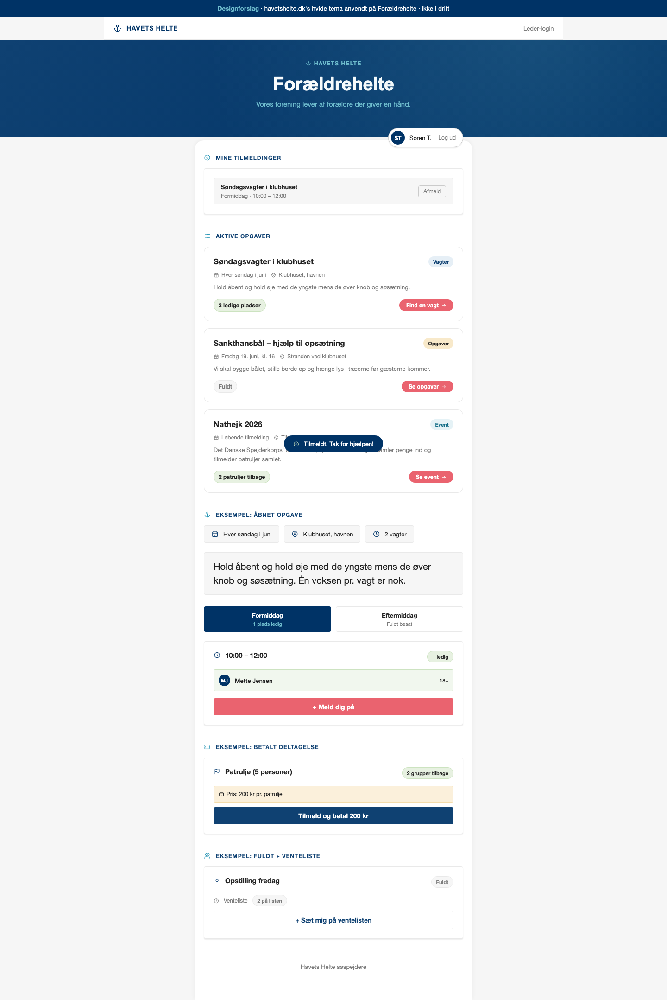

### Section Clips (screens/sections/)

*Clipped individual sections and components*


### Interaction States (screens/states/)

*Hover, focus, and active state captures*


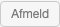


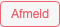


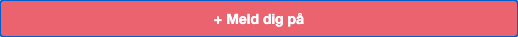


### Screenshot Index (screens/INDEX.md)

# Screenshot Index

## Scroll Journey

> Shows the cinematic state at each point of the page

| Scroll | Y Position | File |
|--------|-----------|------|
| 0% | 0px | `screens/scroll/scroll-000.png` |
| 17% | 214px | `screens/scroll/scroll-017.png` |
| 33% | 415px | `screens/scroll/scroll-033.png` |
| 50% | 629px | `screens/scroll/scroll-050.png` |
| 67% | 842px | `screens/scroll/scroll-067.png` |
| 83% | 1043px | `screens/scroll/scroll-083.png` |
| 100% | 1257px | `screens/scroll/scroll-100.png` |

## Pages

| Page | URL | File |
|------|-----|------|
| Forældrehelte · designforslag (havetshelte.dk hvidt tema) | `http://localhost:8743` | `screens/pages/home.png` |

## Sections

| Page | Section | File |
|------|---------|------|
| home | #1 ([class*="hero"]) | `screens/sections/home-section-1.png` |

