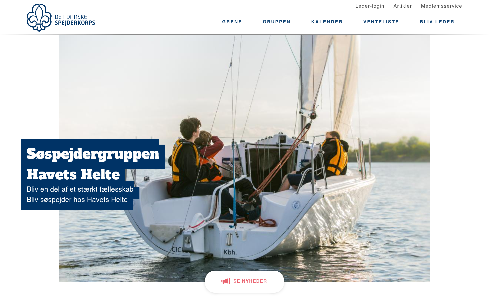

# havetshelte Design System

You are building UI for **havetshelte**. Dark-themed, neutral palette, sans-serif typography (Helvetica Neue), standard density on a 5px grid.

## Visual Reference

**IMPORTANT**: Study ALL screenshots below before writing any UI. Match colors, typography, spacing, layout, and motion exactly as shown.

### Homepage



> Read `references/DESIGN.md` for full token details.

## Design Philosophy

- **Layered depth** — use shadow tokens to create a sense of physical layering. Each elevation level has a specific shadow.
- **Gradient accents** — gradients are used thoughtfully for emphasis, not decoration.
- **Type pairing** — Helvetica Neue for body/UI text, Arial for headings/display. Never introduce a third typeface.
- **standard density** — 5px base grid. Every dimension is a multiple of 5.
- **neutral palette** — the color temperature runs neutral, matching the sans-serif typography.
- **Subtle motion** — transitions smooth state changes. Keep durations under 300ms, use ease-out curves.

## Color System

### Core Palette

| Role | Token | Hex | Use |
|------|-------|-----|-----|
| Background | `--background` | `#333333` | Page/app background |
| Surface | `--surface` | `#000000` | Cards, panels, modals |
| Text Primary | `--text-primary` | `#ffffff` | Headings, body text |
| Text Muted | `--text-muted` | `#7c7c7c` | Captions, placeholders |
| Border | `--border` | `#454545` | Dividers, card borders |

### Status Colors

| Status | Hex | Use |
|--------|-----|-----|
| Success | `#c9e1bd` | Confirmations, positive trends |
| Warning | `#f4daa6` | Caution states, pending items |
| Danger | `#ea636f` | Errors, destructive actions |

### Extended Palette

- `#003366`
- `#337ab7`
- `#0f4172`
- `#f6f6f6` — Light surface or highlight color
- `#e9e9e9` — Light surface or highlight color
- `#2c98b7`
- `#cbcbcb`
- `#f9c9bf`

## Typography

### Font Stack

- **Helvetica Neue** — Heading 1, Heading 2, Heading 3
- **Arial** — Body, Caption

### Font Sources

```css
@font-face {
  font-family: "Alfa Slab One";
  src: url("fonts/AlfaSlabOne-Regular.ttf") format("truetype");
  font-weight: 400;
}
@font-face {
  font-family: "Enriqueta";
  src: url("fonts/Enriqueta-Bold.ttf") format("truetype");
  font-weight: 700;
}
@font-face {
  font-family: "Enriqueta";
  src: url("fonts/Enriqueta-Regular.ttf") format("truetype");
  font-weight: 400;
}
```

### Type Scale

| Role | Family | Size | Weight |
|------|--------|------|--------|
| Heading 1 | Helvetica Neue | 50px | 700 |
| Heading 2 | Helvetica Neue | 46px | 700 |
| Heading 3 | Helvetica Neue | 40px | 700 |
| Body | Arial | 20px | 400 |
| Caption | Arial | 22px | 400 |

### Typography Rules

- Body/UI: **Helvetica Neue**, Headings: **Arial** — these are the only display fonts
- Max 3-4 font sizes per screen
- Headings: weight 600-700, body: weight 400
- Use color and opacity for text hierarchy, not additional font sizes
- Line height: 1.5 for body, 1.2 for headings

## Spacing & Layout

### Base Grid: 5px

Every dimension (margin, padding, gap, width, height) must be a multiple of **5px**.

### Spacing Scale

`5, 10, 15, 20, 25, 30, 35, 40, 45, 50, 55, 60` px

### Spacing as Meaning

| Spacing | Use |
|---------|-----|
| 2.5-5px | Tight: related items within a group |
| 10px | Medium: between groups |
| 15-20px | Wide: between sections |
| 30px+ | Vast: major section breaks |

### Border Radius

Scale: `0px 2px 2px 0px, 0.1em, .12em, 1em, 2px, 2px 0px 0px 2px, 3px, 4px, 6px, 7px, 10em, 12px, 20px, 50px, 999px`
Default: `4px`

### Container

Max-width: `991px`, centered with auto margins.

### Breakpoints

| Name | Value |
|------|-------|
| md | 48em |
| lg | 60em |
| xs | 480px |
| sm | 600px |
| md | 767px |
| md | 768px |
| lg | 991px |
| lg | 992px |
| xl | 1026px |
| xl | 1199px |
| xl | 1200px |

Mobile-first: design for small screens, layer on responsive overrides.

## Component Patterns

### Card

```css
.card {
  background: #000000;
  border: 1px solid #454545;
  border-radius: 4px;
  padding: 20px;
  box-shadow: 0 0 3px 1px rgb(94,158,214);
}
```

```html
<div class="card">
  <h3>Card Title</h3>
  <p>Card content goes here.</p>
</div>
```

### Button

```css
/* Primary */
.btn-primary {
  background: #444444;
  color: #ffffff;
  border-radius: 4px;
  padding: 10px 20px;
  font-weight: 500;
  transition: opacity 150ms ease;
}
.btn-primary:hover { opacity: 0.9; }

/* Ghost */
.btn-ghost {
  background: transparent;
  border: 1px solid #454545;
  color: #ffffff;
  border-radius: 4px;
  padding: 10px 20px;
}
```

```html
<button class="btn-primary">Get Started</button>
<button class="btn-ghost">Learn More</button>
```

### Input

```css
.input {
  background: #333333;
  border: 1px solid #454545;
  border-radius: 4px;
  padding: 10px 15px;
  color: #ffffff;
  font-size: 14px;
}
.input:focus { border-color: var(--accent); outline: none; }
```

```html
<input class="input" type="text" placeholder="Search..." />
```

### Badge / Chip

```css
.badge {
  display: inline-flex;
  align-items: center;
  padding: 5px 10px;
  border-radius: 9999px;
  font-size: 12px;
  font-weight: 500;
  background: #000000;
  color: #7c7c7c;
}
```

```html
<span class="badge">New</span>
<span class="badge">Beta</span>
```

### Modal / Dialog

```css
.modal-backdrop { background: rgba(0, 0, 0, 0.6); }
.modal {
  background: #000000;
  border: 1px solid #454545;
  border-radius: 999px;
  padding: 30px;
  max-width: 480px;
  width: 90vw;
  box-shadow: 15px 0 0#036,-15px 0 0#036;
}
```

```html
<div class="modal-backdrop">
  <div class="modal">
    <h2>Dialog Title</h2>
    <p>Dialog content.</p>
    <button class="btn-primary">Confirm</button>
    <button class="btn-ghost">Cancel</button>
  </div>
</div>
```

### Table

```css
.table { width: 100%; border-collapse: collapse; }
.table th {
  text-align: left;
  padding: 10px 15px;
  font-weight: 500;
  font-size: 12px;
  color: #7c7c7c;
  text-transform: uppercase;
  letter-spacing: 0.05em;
  border-bottom: 1px solid #454545;
}
.table td {
  padding: 15px;
  border-bottom: 1px solid #454545;
}
```

```html
<table class="table">
  <thead><tr><th>Name</th><th>Status</th><th>Date</th></tr></thead>
  <tbody>
    <tr><td>Item One</td><td>Active</td><td>Jan 1</td></tr>
    <tr><td>Item Two</td><td>Pending</td><td>Jan 2</td></tr>
  </tbody>
</table>
```

### Navigation

```css
.nav {
  display: flex;
  align-items: center;
  gap: 10px;
  padding: 15px 20px;
  border-bottom: 1px solid #454545;
}
.nav-link {
  color: #7c7c7c;
  padding: 10px 15px;
  border-radius: 4px;
  transition: color 150ms;
}
.nav-link:hover { color: #ffffff; }
```

```html
<nav class="nav">
  <a href="/" class="nav-link active">Home</a>
  <a href="/about" class="nav-link">About</a>
  <a href="/pricing" class="nav-link">Pricing</a>
  <button class="btn-primary" style="margin-left: auto">Get Started</button>
</nav>
```

### Extracted Components

These components were found in the codebase:

**Navigation** (`html`)

## Page Structure

The following page sections were detected:

- **Navigation** — Top navigation bar (3 items)
- **Hero** — Hero section (detected from heading structure)
- **Footer** — Page footer with links and info (5 items)
- **Cta** — Call-to-action section

When building pages, follow this section order and structure.

## Animation & Motion

This project uses **subtle motion**. Transitions smooth state changes without calling attention.

### CSS Animations

- `fa-spin`
- `animate-stripes`

### Motion Tokens

- **Duration scale:** `150ms`, `200ms`, `300ms`, `400ms`, `500ms`
- **Easing functions:** `ease-in-out`, `ease-out`, `ease-in`

### Motion Guidelines

- **Duration:** Use values from the duration scale above. Short (150ms) for micro-interactions, long (500ms) for page transitions
- **Easing:** Use `ease-in-out` as the default easing curve
- **Direction:** Elements enter from bottom/right, exit to top/left
- **Reduced motion:** Always respect `prefers-reduced-motion` — disable animations when set

## Depth & Elevation

### Shadow Tokens

- Subtle: `inset 1px 1px 1px #ccc`
- Subtle: `0 2px 2px rgba(0,0,0,0.2)`
- Raised (cards, buttons): `0 0 3px 1px rgb(94,158,214)`
- Raised (cards, buttons): `0 0 5px #666666`
- Raised (cards, buttons): `0 2px 2px 0 rgba(0,0,0,0.14),0 1px 5px 0 rgba(0,0,0,0.12),0 3px 1px -2px rgba(0,0,0,0.2)`
- Raised (cards, buttons): `0 0 3px #000`

### Z-Index Scale

`1, 2, 3, 5, 6, 10, 20, 30, 100, 1000, 1260, 9999`

Use these exact values — never invent z-index values.

## Anti-Patterns (Never Do)

- **No blur effects** — no backdrop-blur, no filter: blur()
- **No zebra striping** — tables and lists use borders for separation
- **No invented colors** — every hex value must come from the palette above
- **No arbitrary spacing** — every dimension is a multiple of 5px
- **No extra fonts** — only Helvetica Neue and Arial are allowed
- **No arbitrary border-radius** — use the scale: 0.1em, .12em, 1em, 2px, 3px, 4px, 6px, 7px, 10em, 12px
- **No opacity for disabled states** — use muted colors instead

## Workflow

1. **Read** `references/DESIGN.md` before writing any UI code
2. **Pick colors** from the Color System section — never invent new ones
3. **Set typography** — Helvetica Neue, Arial only, using the type scale
4. **Build layout** on the 5px grid — check every margin, padding, gap
5. **Match components** to patterns above before creating new ones
6. **Apply elevation** — use shadow tokens
7. **Validate** — every value traces back to a design token. No magic numbers.

## Brand Spec

- **Favicon:** `/core/misc/favicon.ico`
- **Site URL:** `https://havetshelte.dk`
- **Brand typeface:** Helvetica Neue

## Quick Reference

```
Background:     #333333
Surface:        #000000
Text:           #ffffff / #7c7c7c
Accent:         (not extracted)
Border:         #454545
Font:           Helvetica Neue
Spacing:        5px grid
Radius:         4px
Components:     8 detected
```

## When to Trigger

Activate this skill when:
- Creating new components, pages, or visual elements for havetshelte
- Writing CSS, Tailwind classes, styled-components, or inline styles
- Building page layouts, templates, or responsive designs
- Reviewing UI code for design consistency
- The user mentions "havetshelte" design, style, UI, or theme
- Generating mockups, wireframes, or visual prototypes

---

# Full Reference Files

> Every output file is embedded below. Claude has full design system context from /skills alone.

## Design System Tokens (DESIGN.md)

# havetshelte DESIGN.md

> Auto-generated design system — reverse-engineered via static analysis by skillui.
> Frameworks: None detected
> Colors: 20 · Fonts: 2 · Components: 8
> Icon library: not detected · State: not detected
> Primary theme: dark · Dark mode toggle: no · Motion: subtle

## Visual Reference

**Match this design exactly** — study colors, fonts, spacing, and component shapes before writing any UI code.


---

## 1. Visual Theme & Atmosphere

This is a **dark-themed** interface with a neutral tone. Depth is expressed through layered shadows and subtle surface color variation. Typography pairs **Arial** for display/headings with **Helvetica Neue** for body text, creating clear visual hierarchy through type contrast. Spacing follows a **5px base grid** (standard density), with scale: 5, 10, 15, 20, 25, 30, 35, 40px. Motion is subtle — smooth transitions (150-300ms) ease state changes without drawing attention.

---

## 2. Color Palette & Roles

| Token | Hex | Role | Use |
|---|---|---|---|
| background | `#333333` | background | Page background, darkest surface |
| surface | `#000000` | surface | Card and panel backgrounds |
| theme-color | `#ffffff` | text-primary | Headings and body text |
| text-muted | `#7c7c7c` | text-muted | Captions, placeholders, secondary info |
| border | `#454545` | border | Dividers, card borders, outlines |
| danger | `#ea636f` | danger | Error states, destructive actions |
| success | `#c9e1bd` | success | Success states, positive indicators |
| warning | `#f4daa6` | warning | Warning states, caution indicators |
| info | `#003366` | info | Informational highlights |
| unknown | `#337ab7` | unknown | Palette color |
| unknown | `#0f4172` | unknown | Palette color |
| unknown | `#f6f6f6` | unknown | Palette color |
| unknown | `#e9e9e9` | unknown | Palette color |
| unknown | `#2c98b7` | unknown | Palette color |
| unknown | `#cbcbcb` | unknown | Palette color |
| unknown | `#f9c9bf` | unknown | Palette color |
| unknown | `#146e88` | unknown | Palette color |
| unknown | `#232323` | unknown | Palette color |
| unknown | `#6ebccd` | unknown | Palette color |
| unknown | `#555555` | unknown | Palette color |


---

## 3. Typography Rules

**Font Stack:**
- **Helvetica Neue** — Heading 1, Heading 2, Heading 3
- **Arial** — Body, Caption

**Font Sources:**

```css
@font-face {
  font-family: "Alfa Slab One";
  src: url("fonts/AlfaSlabOne-Regular.ttf") format("truetype");
  font-weight: 400;
}
@font-face {
  font-family: "Enriqueta";
  src: url("fonts/Enriqueta-Bold.ttf") format("truetype");
  font-weight: 700;
}
@font-face {
  font-family: "Enriqueta";
  src: url("fonts/Enriqueta-Regular.ttf") format("truetype");
  font-weight: 400;
}
```

| Role | Font | Size | Weight |
|---|---|---|---|
| Heading 1 | Helvetica Neue | 50px | 700 |
| Heading 2 | Helvetica Neue | 46px | 700 |
| Heading 3 | Helvetica Neue | 40px | 700 |
| Body | Arial | 20px | 400 |
| Caption | Arial | 22px | 400 |

**Typographic Rules:**
- Limit to 2 font families max per screen
- Use **Helvetica Neue** for body/UI text, **Arial** for display/headings
- Maintain consistent hierarchy: no more than 3-4 font sizes per screen
- Headings use bold (600-700), body uses regular (400)
- Line height: 1.5 for body text, 1.2 for headings
- Use color and opacity for secondary hierarchy, not additional font sizes


---

## 4. Component Stylings

### Layout (1)

**Footer** — `html`

### Navigation (1)

**Navigation** — `html`

### Data Display (1)

**Badge** — `html`

### Data Input (1)

**Button** — `html`
- Animation: 

### Overlay (1)

**Modal** — `html`

### Media (3)

**Image** — `html`

**Icon** — `html`

**Map/Canvas** — `html`


---

## 5. Layout Principles

- **Base spacing unit:** 5px
- **Spacing scale:** 5, 10, 15, 20, 25, 30, 35, 40, 45, 50, 55, 60
- **Border radius:** 0px 2px 2px 0px, 0.1em, .12em, 1em, 2px, 2px 0px 0px 2px, 3px, 4px, 6px, 7px, 10em, 12px, 20px, 50px, 999px
- **Max content width:** 991px

**Spacing as Meaning:**
| Spacing | Use |
|---|---|
| 2.5-5px | Tight: related items within a group |
| 10px | Medium: between groups |
| 15-20px | Wide: between sections |
| 30px+ | Vast: major section breaks |


---

## 6. Depth & Elevation

### Flat — subtle depth hints

- `inset 1px 1px 1px #ccc`
- `0 2px 2px rgba(0,0,0,0.2)`

### Raised — cards, buttons, interactive elements

- `0 0 3px 1px rgb(94,158,214)`
- `0 0 5px #666666`
- `0 2px 2px 0 rgba(0,0,0,0.14),0 1px 5px 0 rgba(0,0,0,0.12),0 3px 1px -2px rgba(0,0,0,0.2)`

### Floating — dropdowns, popovers, modals

- `15px 0 0#036,-15px 0 0#036`
- `rgb(0, 51, 102) 15px 0px 0px 0px, rgb(0, 51, 102) -15px 0px 0px 0px`

### Z-Index Scale

`1, 2, 3, 5, 6, 10, 20, 30, 100, 1000, 1260, 9999`


---

## 7. Animation & Motion

This project uses **subtle motion**. Transitions smooth state changes without demanding attention.

### CSS Animations

- `@keyframes fa-spin`
- `@keyframes animate-stripes`

### Animated Components

- **Button**: 

### Motion Guidelines

- Duration: 150-300ms for micro-interactions, 300-500ms for page transitions
- Easing: `ease-out` for enters, `ease-in` for exits
- Always respect `prefers-reduced-motion`


---

## 8. Do's and Don'ts

### Do's

- Use `#333333` as the primary page background
- Pair **Helvetica Neue** (body) with **Arial** (display) — these are the only allowed fonts
- Follow the **5px** spacing grid for all margins, padding, and gaps
- Use the defined shadow tokens for elevation — see Section 6
- Use border-radius from the scale: 0px 2px 2px 0px, 0.1em, .12em, 1em, 2px
- Reuse existing components from Section 4 before creating new ones

### Don'ts

- Don't introduce colors outside this palette — extend the design tokens first
- Don't introduce additional font families beyond Helvetica Neue and Arial
- Don't use arbitrary spacing values — stick to multiples of 5px
- Don't create custom box-shadow values outside the system tokens
- Don't use arbitrary border-radius values — pick from the defined scale
- Don't duplicate component patterns — check Section 4 first
- Don't use backdrop-blur or blur effects

### Anti-Patterns (detected from codebase)

- No blur or backdrop-blur effects
- No zebra striping on tables/lists


---

## 9. Responsive Behavior

| Name | Value | Source |
|---|---|---|
| md | 48em | css |
| lg | 60em | css |
| xs | 480px | css |
| sm | 600px | css |
| md | 767px | css |
| md | 768px | css |
| lg | 991px | css |
| lg | 992px | css |
| xl | 1026px | css |
| xl | 1199px | css |
| xl | 1200px | css |

**Approach:** Use `@media (min-width: ...)` queries matching the breakpoints above.


---

## 10. Agent Prompt Guide

Use these as starting points when building new UI:

### Build a Card

```
Background: #000000
Border: 1px solid #454545
Radius: 4px
Padding: 20px
Font: Helvetica Neue
Use shadow tokens from Section 6.
```

### Build a Button

```
Primary: bg var(--accent), text white
Ghost: bg transparent, border #454545
Padding: 10px 20px
Radius: 4px
Hover: opacity 0.9 or lighter shade
Focus: ring with var(--accent)
```

### Build a Page Layout

```
Background: #333333
Max-width: 991px, centered
Grid: 5px base
Responsive: mobile-first, breakpoints from Section 9
```

### Build a Stats Card

```
Surface: #000000
Label: #7c7c7c (muted, 12px, uppercase)
Value: #ffffff (primary, 24-32px, bold)
Status: use success/warning/danger from Section 2
```

### Build a Form

```
Input bg: #333333
Input border: 1px solid #454545
Focus: border-color var(--accent)
Label: #7c7c7c 12px
Spacing: 20px between fields
Radius: 4px
```

### General Component

```
1. Read DESIGN.md Sections 2-6 for tokens
2. Colors: only from palette
3. Font: Helvetica Neue, type scale from Section 3
4. Spacing: 5px grid
5. Components: match patterns from Section 4
6. Elevation: shadow tokens
```

## Bundled Fonts (fonts/)

The following font files are bundled in the `fonts/` directory:

- `fonts/AlfaSlabOne-Regular.ttf`
- `fonts/Enriqueta-Bold.ttf`
- `fonts/Enriqueta-Medium.ttf`
- `fonts/Enriqueta-Regular.ttf`
- `fonts/Enriqueta-SemiBold.ttf`

Use these local font files in `@font-face` declarations instead of fetching from Google Fonts.

## Homepage Screenshots (screenshots/)


